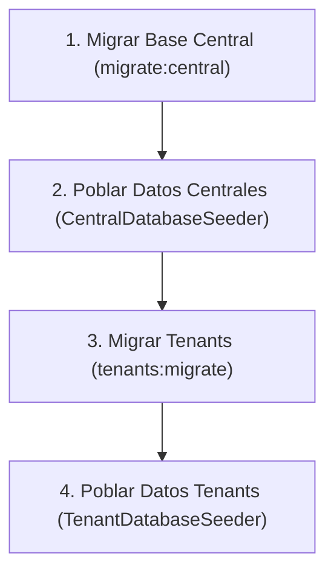

# Guía de Migraciones y Base de Datos Multi-Tenant en AulaSync

AulaSync utiliza una arquitectura **Multi-Tenant** con bases de datos separadas para cada sede/inquilino y una base de datos central compartida.

---

## 1. Arquitectura de Base de Datos

| Base de Datos | Conexión Laravel | Ubicación de Migraciones | Propósito |
| :--- | :--- | :--- | :--- |
| **Central** (`aulamanager_central`) | `mysql` (default) | `database/migrations/central/` | Sedes, tenants, usuarios, roles, permisos globales y periodos académicos. |
| **Tenants** (`aulamanager_{domain}`) | `tenant` | `database/migrations/tenant/` | Datos específicos de la sede: espacios, pisos, carreras, asignaturas, módulos, horarios, reservas, asistencias, etc. |

### Tenants configurados por sede:
* **Concepción (`ccp`)**: Base de datos `aulamanager_ccp`
* **Chillán (`ch`)**: Base de datos `aulamanager_ch`
* **Cañete (`ct`)**: Base de datos `aulamanager_ct`
* **Los Ángeles (`la`)**: Base de datos `aulamanager_la`
* **Talcahuano (`th`)**: Base de datos `aulamanager_th`

---

## 2. Orden de Ejecución Obligatorio

> [!IMPORTANT]
> **Siempre se debe migrar la base de datos central primero.**
> El comando de migración de tenants consulta la tabla `aulamanager_central.tenants` para obtener la lista de bases de datos a migrar. Si la base central no está migrada, fallará con el error `Table 'aulamanager_central.tenants' doesn't exist`.



---

## 3. Comandos de Migración

### A. Base de Datos Central

#### Ejecutar migraciones pendientes:
```bash
php artisan migrate:central
```

#### Reiniciar base central desde cero y aplicar seeders:
```bash
php artisan migrate:central --fresh --seed
```
*O con el comando nativo de Laravel:*
```bash
php artisan migrate:fresh --path=database/migrations/central
php artisan db:seed --class=CentralDatabaseSeeder
```

---

### B. Bases de Datos de Tenants

#### Migrar todas las sedes (inquilinos):
```bash
php artisan tenants:migrate
```

#### Reiniciar todas las bases de tenants desde cero y cargar seeders:
```bash
php artisan tenants:migrate --fresh --seed
```

#### Migrar y poblar solo una sede específica:
Puedes indicar el subdominio de la sede como argumento:
```bash
# Ejemplo: Solo Concepción
php artisan tenants:migrate ccp --fresh --seed

# Ejemplo: Solo Talcahuano
php artisan tenants:migrate th --fresh --seed

# Ejemplo: Solo Los Ángeles
php artisan tenants:migrate la --fresh --seed
```

#### Asistente interactivo de configuración (Verifica y crea las BDs si no existen):
```bash
php artisan tenants:setup --fresh --seed
```

#### Revertir (Rollback) la última migración en los tenants:
```bash
php artisan tenants:migrate:rollback --step=1
```

---

## 4. Creación de Nuevas Migraciones

Al crear una migración, especifica la ruta según corresponda:

### Para la base de datos Central:
```bash
php artisan make:migration nombre_de_la_migracion --path=database/migrations/central
```

### Para las bases de datos de los Tenants:
```bash
php artisan make:migration nombre_de_la_migracion --path=database/migrations/tenant
```

---

## 5. Seeders del Sistema

* **Centrales:** Se gestionan a través de `CentralDatabaseSeeder`, el cual orquesta:
  * Regiones/Comunas (`AdministracionChileSeeder`)
  * Universidad y Sedes (`UniversidadSeeder`, `SedeSeeder`, `CampusSeeder`)
  * Roles y Permisos (`RoleSeeder`, `NewMaintainersPermissionsSeeder`)
  * Usuarios administrativos (`UserSeeder`, `Usuarios...Seeder`)
  * Tenants (`TenantSeeder`)
  * Periodos Académicos (`PeriodoAcademicoSeeder`)

* **Por Tenant:** Se gestionan a través de `TenantDatabaseSeeder`, el cual orquesta por cada sede:
  * Facultades (`FacultadSeeder`)
  * Áreas Académicas (`AreaAcademicaSeeder`)
  * Carreras (`CarreraSeeder`)
  * Módulos y Bloques Horarios (`ModulosSeeder`)
  * Tipos de Correos (`TiposCorreosMasivosSeeder`)
  * Pisos (`PisoSeeder`)
  * Espacios físicos y generación de QR (`EspacioSeeder`)
